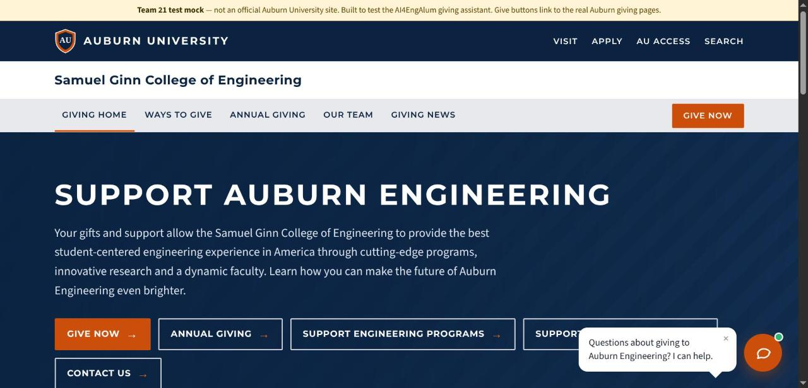
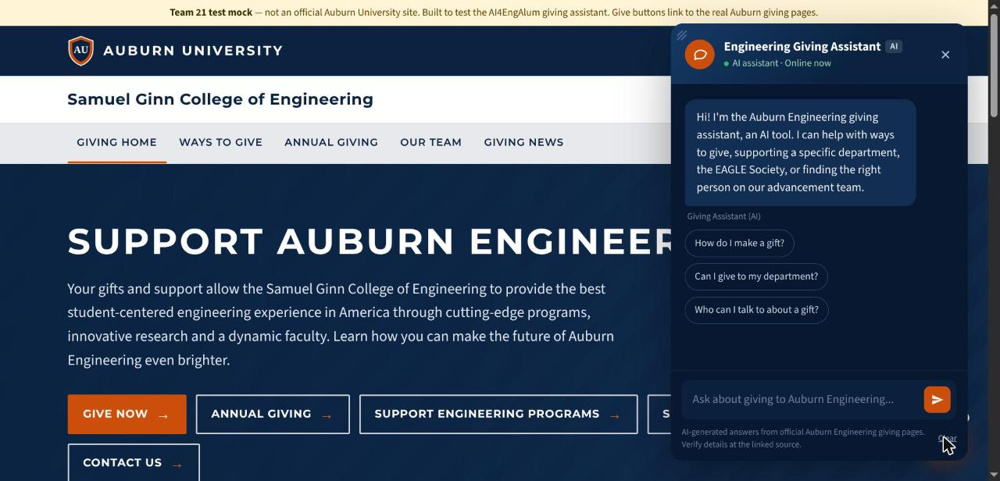
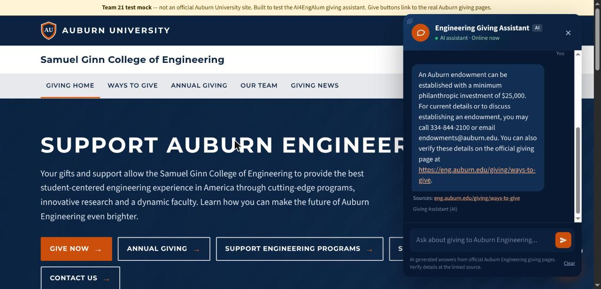
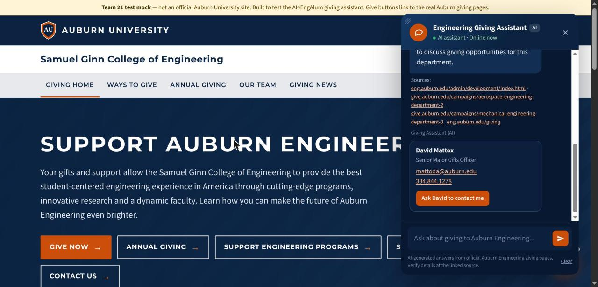
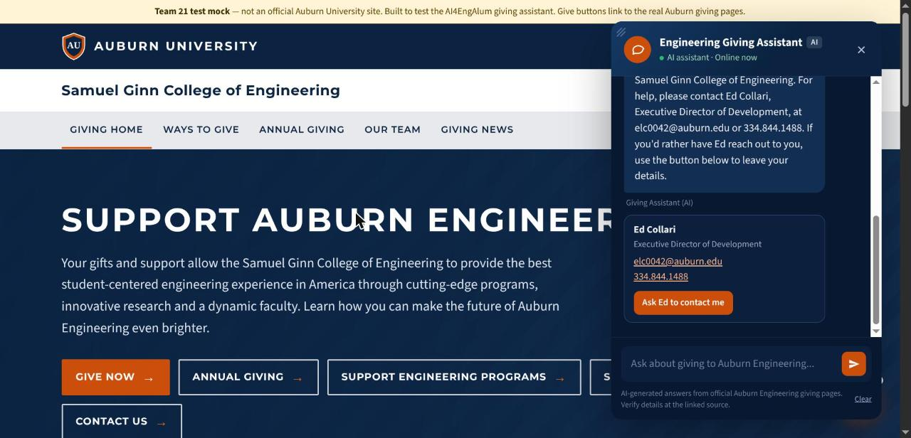
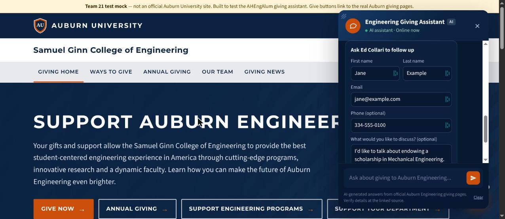
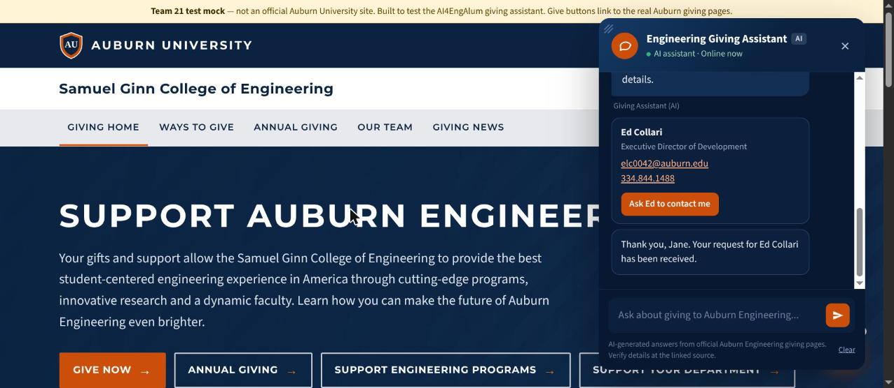
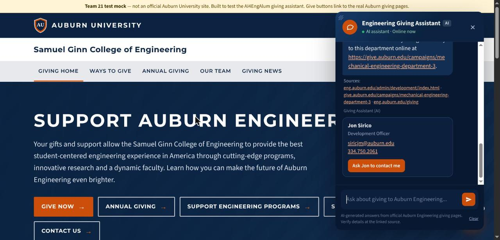

# Engineering Giving Assistant — User Guide for Engineering Advancement

**Draft, November 1, 2026.** Team 21 (AI4EngAlum), Auburn COMP 4710. For Ed Collari and the
Engineering Advancement staff who will use and look after the assistant.

You don't need any technical background for this guide. Hosting details for the Engineering web team
are in [`WEB_TEAM_HANDOFF.md`](WEB_TEAM_HANDOFF.md).

---

## 1. What the assistant is

The Engineering Giving Assistant is a chat box on the Engineering giving pages. Visitors type a
question about giving to the Samuel Ginn College of Engineering and get a short answer in a few
seconds, with a link to the official page it came from.

**What it does**

- Answers questions about ways to give, giving to a department, endowments, planned giving, giving
  societies (EAGLE Society, Sam's Circle and others) and donor events.
- Tells visitors who to talk to: each department's development liaison, the contact for a program
  (the Brick program, 100+ Women Strong, room naming…) or the development officer for their region.
- When it can't answer, gives Ed Collari's contact details and offers to have him reach out.
- Emails Ed the giving questions it couldn't answer, so the office can see what visitors are asking.

**What it does not do**

- It has **no connection to OAK or any donor record**. It cannot see who has given or how much.
- It never gives tax or legal advice (for example, whether a gift is deductible). It points the
  visitor to a staff contact and suggests a tax adviser.
- It answers only from the information Advancement approved (section 5). If the answer isn't there,
  it says so instead of guessing.
- It does not answer questions unrelated to Engineering giving (athletics, admissions, other
  colleges, homework, small talk).
- It does not store conversations.

---

## 2. What visitors see

1. **The launcher.** An orange chat button in the bottom-right corner. Shortly after the page loads,
   a bubble says *"Questions about giving to Auburn Engineering? I can help."* Visitors can close it.

   
2. **The greeting.** When the chat opens, the assistant introduces itself as *"the Auburn
   Engineering giving assistant, an AI tool"* and offers three starter questions: *How do I make a
   gift?*, *Can I give to my department?*, *Who can I talk to about a gift?*

   
3. **Answers.** Each answer is two to four sentences, labeled **Giving Assistant (AI)**, with a link to
   the official page. The header and footer also say the answers are AI-generated and should be
   checked at the linked source.

   
4. **Contact cards.** When a visitor asks who to talk to, the assistant shows that staff member's
   card: name, title, email, phone, and a button such as **Ask Jon to contact me**.

   
5. **When it can't answer.** The reply gives Ed's details first, then shows his card with
   **Ask Ed to contact me**.

   
6. **The follow-up form.** Opened from any contact card, or shown right away when a visitor asks to be
   contacted ("can someone call me?"). It asks for first and last name and email (required), phone and
   a message (optional), and a consent box: *"I agree that Auburn Engineering Advancement may store
   these details and contact me."* Nothing is sent until the box is ticked. Afterwards the visitor sees
   *"Thank you, <name>. Your request … has been received."*

   

   
7. **Follow-up questions work.** A visitor can ask "Who handles Aerospace?" and then "What about
   Mechanical?" The assistant uses the last few messages to understand the follow-up.

   
8. **Clearing.** The **Clear** button erases the conversation. Reloading or leaving the page also
   erases it.

---

## 3. What Advancement receives

Both kinds of email go to **Ed Collari** (elc0042@auburn.edu) by default. Other recipients can be
added (section 7).

### 3a. Follow-up requests

Sent as soon as a visitor submits the form.

> **Subject:** Giving assistant: follow-up request from Jane Smith
>
> Jane Smith asked for a follow-up from Ed Collari through the giving assistant.
>
> Email: jane@example.com
> Phone: 334-555-0100
> Received: 2026-11-03T15:04:00+00:00 (UTC)
>
> Message:
> I'd like to talk about endowing a scholarship in Mechanical Engineering.
>
> The visitor consented to being contacted. The chat conversation is not stored or attached.

**What to do:** reply to the email. It goes straight to the visitor (the visitor's address is set
as the reply-to). If the visitor picked a specific staff member, that person's name is in the first
line. Forward it to them, or ask the web team to copy those staff automatically (section 7).

Each request is also saved on the assistant's server in case an email doesn't arrive (section 4).

### 3b. Unanswered questions

Sent when a visitor finishes a chat in which the assistant couldn't answer one or more **giving**
questions: when they close or clear the chat, leave the page, or stop asking for 10 minutes.

> **Subject:** Giving assistant: 2 unanswered questions
>
> A visitor asked the giving assistant these questions and it had no approved answer:
>
> - Can I donate cryptocurrency to the College of Engineering?
> - Does Auburn Engineering accept gifts of real estate?
>
> Only the question text is sent. The visitor is anonymous, the rest of the conversation is not
> included, and nothing is stored.

**What to do:** nothing urgent. The visitor was already given Ed's details. Once a month, look for
questions that keep coming up. Each one is a candidate for a new answer in the content document
(section 5).

Off-topic questions ("who won the game?"), attempts to misuse the assistant and requests for private
information are **not** emailed, so the inbox only gets genuine giving questions.

---

## 4. Where follow-up requests are stored

Each submitted form is saved as one line in a file on the assistant's server:

| Where the assistant runs | File |
|---|---|
| Web team's server | Set by the web team (`CONTACT_REQUESTS_FILE`) |
| The Windows laptop | `%LOCALAPPDATA%\AI4EngAlum\data\contact_requests.jsonl` |
| A Linux development machine | `rag/data/contact_requests.jsonl` in the project folder |

The file holds only what the visitor typed in the form, plus the time. It never holds the chat. The
file contains personal information, so only people who handle donor follow-ups should be able to open
it. **Open decision for Advancement:** where this file should live once hosted, who can read it, and
how long to keep requests.

---

## 5. Keeping the information current

The assistant knows only what is in two places:

1. **The content document**: `content/AI4EngAlum Giving Content for RAG` (Word or LibreOffice).
   Hand-written answers about ways to give, endowments, societies, events and so on, each with the
   official page it came from. **Advancement can edit this document directly.**
2. **The official web pages**: the Engineering Advancement staff directory and the ten department
   giving pages. The assistant keeps a text copy that is refreshed by re-reading the pages.

| If this changes… | Do this |
|---|---|
| An answer, amount, policy or program description | Edit the content document, then ask whoever hosts the assistant to rebuild it (about 5 minutes) |
| Staff joins, leaves, or changes role, phone or departments | Update the official staff directory page as usual, then have the pages re-read and rebuilt (about 10 minutes) |
| The main point of contact (currently Ed) | Tell the web team. It is a settings change, not a content edit |

The assistant picks up staff changes from the directory automatically. On October 29, 2026, a
refresh picked up Chris Harris as liaison to Electrical and Computer and to Civil and Environmental
Engineering, and Avery Storm as the new development coordinator, without any code changes.

**Rules for editing the content document**

- Keep each answer under its heading in the form `GIVING-<TOPIC>-01 — <the question>`.
- Every answer needs a `Source:` line with the official web address. The rebuild refuses an answer
  without one, so nothing unverifiable gets in.
- Don't rename the section headings ("Recommended Response Rules", "Proposed RAG Chunks", and the
  others).
- The **Recommended Response Rules** section is the assistant's instructions on tone and what to
  decline. Changes there need no rebuild: whoever hosts the assistant reloads the rules with one
  command (on the laptop, stop and start it).

**Suggested schedule:** update when something changes; re-read the official pages at least once a
semester; review the unanswered-question emails monthly.

Technical steps for whoever does the rebuild: [`CONTENT_REFRESH.md`](CONTENT_REFRESH.md).

---

## 6. Running it on the Windows laptop

For demos, testing (for example by Tyler), or if the assistant is delivered on a laptop before the web
team hosts it. The scripts are in the project's `windows` folder. Double-click them.

| Script | When to use it |
|---|---|
| **Setup.bat** | Once, the first time (installs everything, about 7 GB of downloads, and runs the checks). Ends with **SETUP COMPLETE** in green. |
| **Start.bat** | Each time you want to use it. A browser opens at `http://localhost:8000/` with a copy of the giving pages and the chat box. |
| **Stop.bat** | When you are done. Wait for the green **STOPPED** message. |
| **Status.bat** | To check whether it is running, without changing anything. |

Pressing **Ctrl+C** in the Start window also stops everything. If you closed that window with the X
instead, run **Stop.bat**.

On the laptop, email notifications are off. Follow-up requests are only saved to the file in
section 4.

---

## 7. Changes the web team can make on request

These are settings, not code changes:

- Add more people to the notification emails, or also email the staff member a visitor picked.
- Change the main point of contact (name, title, email, phone).
- Change the spam limit (now 5 form submissions per 10 minutes from one connection).
- Send notifications to a Teams channel instead of email.

---

## 8. Troubleshooting

| What you see | Likely cause | What to do |
|---|---|---|
| The chat says *"I'm having trouble reaching the assistant right now…"* | The assistant's server or AI model is stopped | Web team: restart it. Laptop: run Start.bat. Visitors are still given Ed's contact details. |
| An answer is wrong or out of date | The content document or a scraped page is out of date | Fix it in the content document (section 5) and rebuild. |
| It names the wrong staff member | The staff directory page changed | Re-read the pages and rebuild (section 5). |
| It declines a question it should answer | The answer isn't in the content document | Add it (section 5). The unanswered-question emails show which ones. |
| No follow-up emails arrive | Notifications are off (always on the laptop) or mail delivery failed | Check the requests file (section 4). Web team: check the mail settings. |
| A visitor's form says *"Too many requests…"* | Spam protection: more than 5 submissions from one connection in 10 minutes | Wait 10 minutes. The message also gives Ed's contact details. |
| The first answer after a quiet period takes a few seconds longer | The AI model unloads after 5 idle minutes and reloads on the next question | Normal. |

---

## 9. Common questions

**Can it see donor information?** No. It has no connection to OAK or any donor database.

**Does it store what visitors type?** No. Conversations are never saved. The only thing saved is a
follow-up form a visitor chose to submit with consent. Unanswered-question emails contain only the
question text.

**Can someone make it say something inappropriate?** It is limited to Engineering giving and declines
everything else, including instructions to "ignore its rules". Links it gives are checked against the
approved sources, and every decline ends with Ed's details instead of anything the AI suggested.

**Does it send data to OpenAI or other AI companies?** No. The AI model runs on the assistant's own
server.

**Will it give the same answer to the same question?** Yes. It is set to answer consistently, which
makes it predictable to test.

**How do we know it's accurate?** Before each delivery, the team runs 60 test questions with known
correct answers (amounts, contacts, links, refusals), plus automatic checks of the form, the spam
protection and the emails. All pass as of November 1, 2026.
